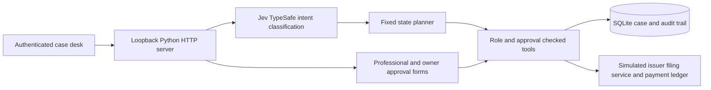

# Habilin

An estate case agent that obtains missing evidence, prepares a reviewed tax packet, executes an authorized sandbox filing and verifies the filing and payment receipts.

## 1 Project overview

- Track: International AI Track, Topic A — AI Personal Finance Assistant, **provisional fit**. Estate administration is not explicitly listed; organizer acceptance is unconfirmed.
- Team: **TEAM NAME TO COMPLETE**. Member details and registration are handled privately by the team.
- Project: Habilin, working name.
- Scope: one synthetic Philippine resident, unmarried, post-2017 death, one investment property that is not the family home, a living co-owner, no other deductions, debts, credits or penalties. A certified title copy from a simulated Registry of Deeds shows a 50% share where the family reported 100%.
- Grounding: every legal rule, office mailbox and statistic cites a primary source. See [VISION.md](VISION.md), [research/PH_ESTATE_LEGAL_SOURCES.md](research/PH_ESTATE_LEGAL_SOURCES.md) and [research/PH_OFFICE_DIRECTORY.md](research/PH_OFFICE_DIRECTORY.md). Office routing uses `habilin/data/bir_rdos.json`, built from BIR's official contact directory (124 district offices, checked 20 October 2026).
- Milestone: simulated filing acceptance plus a settled PHP150,000 sandbox tax payment, then a prepared (never sent) eCAR email to the estate's official BIR district-office mailbox, an anonymous impact summary, and owner-confirmed case closure that deletes personal data while keeping receipts. eCAR, transfer tax, title registration and the tax declaration update remain open.

The automated browser script simulates professional and owner actors using separate role sessions and obtains the code through the local owner command. The simulated ledger advances a pending payment to settled when checked; there is no independent external settlement feed.

No live BIR, bank, registry, professional partner, legal authority or paying pilot is claimed. The record collection and status services are deterministic simulations, not actual government API integrations.

## 2 System architecture



`habilin/intents.py` sends bounded synthetic text to Jev, accepts only catalogued intent IDs, and asks for clarification on uncertain or unavailable results. Jev supplies no amounts, payees, roles, approvals or tool arguments. Responses are fixed explanations of recorded state. `habilin/core.py` owns planning, evidence checks, integer-centavo arithmetic, packet hashes, approval checks, idempotency and ledger reconciliation. `habilin/server.py` authenticates bearer tokens and serves the static case desk. There is no generated code execution or arbitrary URL/file-access tool.

## 3 Environment and dependencies

Python 3.11+; SQLite and HTTP server from the standard library; a modern browser. The app and automated test suite require no pip/npm packages. Tested locally on macOS with Python 3.14; portable Python behavior also checked using the bundled Python 3.12 runtime.

Live semantic routing additionally needs a configured `mcporter` command and Jev MCP using TypeSafe. The recorded run used `@jkudish/jev-mcp`, provider `typesafe`, model alias `jev-latest`. The exact hosted model behind that alias is not pinned. Configure the provider's `TYPESAFE_API_KEY` in its environment, outside this repository; never put credentials in source or recordings. A compatible MCP client command can be selected with `HABILIN_JEV_COMMAND`, a JSON array of executable/arguments. Default: `["mcporter","call","jev.jev_classify"]`.

Live calls send only the supplied message and a fixed synthetic intent catalog; they do not send the case database or approval code. The six-digit input guard prevents an ordinary pasted code being sent to Jev. It is not a general personal-data detector: enter synthetic messages only.

For a machine without an existing MCP connection, install Node.js 20+ and configure the optional live adapter using the installed CLI's supported commands:

```sh
npm install -g mcporter @jkudish/jev-mcp@0.5.0
mcporter config add habilin-jev --command jev-mcp --env JEV_PROVIDER=typesafe --scope home
export HABILIN_JEV_COMMAND='["mcporter","call","habilin-jev.jev_classify"]'
```

Provide `TYPESAFE_API_KEY` to that terminal via your private environment/secret manager before launching the server. The `jev-mcp` child process inherits it; do not write it into the repository or a recorded command. This setup is optional for offline reproduction. The recorded machine already had a configured `jev` connection and used the default command. The third-party CLI commands were checked against installed help/package metadata; the global install path was not rerun on a clean machine.

## 4 Installation and execution

Optional: copy `.env.example` to `.env.local` and add your `TYPESAFE_API_KEY`. `.env.local` is loaded at startup and never committed.

```sh
python3 -m habilin serve --port 8787              # offline fixture routing
python3 -m habilin serve --port 8787 --live-jev   # live Jev/TypeSafe classification
```

The server opens your browser straight into the case desk (use `--no-open` to skip). If the port is taken by another app it picks a free one and prints the address. There is no sign-in screen: this is a local demo where one screen plays all three people, so the page fetches the three role tokens from `/api/demo-session`, which answers only on the loopback host and rejects foreign `Host` or `Origin` headers. Pick a person on the sign-in screen (Maria Reyes, operator; Atty. Jose Cruz, professional; Ana Santos, family representative). The main button hands the case to whoever acts next, and **Switch user** returns to the sign-in screen. Switch cases with the **PH / UK** switcher at the top. **Print summary** gives a one-page case summary to print or save as PDF. Every request still carries that role's own token, the server enforces role and approval checks, and owner approvals still need the one-time code from a separate terminal.

Walkthrough, for either case:

1. **Operator:** click the main button. The agent fetches the official title record, catches the 50% versus 100% ownership mismatch, then asks one question (PH: was it the family home? UK: does the home pass to children or grandchildren?). Answer **No** to continue; **Yes** stops the case for a professional because the tax would change.
2. **Operator:** prepare the packet. PH: PHP150,000. UK: GBP50,000.
3. **Professional:** confirm and record approval.
4. **Owner:** get a one-time code in a separate terminal and approve:
   ```sh
   python3 -m habilin code --directory .runtime --case EST-001      # or EST-UK-001
   ```
5. **Operator:** click three times: lost filing reply, then confirmed filing and pending payment, then verified payment. The PH case drafts (never sends) an eCAR email to the estate's official BIR district-office mailbox. See the **Offices & next steps** and **Impact** tabs.
6. **Owner:** optionally lock the case, then **Close case & delete personal data** (two clicks).

Use a new `--directory` for a fresh demo; each holds its own tokens and database. `python3 -m habilin sessions --directory <dir>` prints the tokens for scripted API use.

## 5 Testing

```sh
python3 -m unittest discover -s tests -v
```

The suite covers both the Philippine and UK cases, the family-home and residence-band questions, office routing from the verified BIR directory, penalty math checked against BIR's RMC 33-2026 example, data deletion at closure (checked on the raw database file), evidence correction, a complete case, unknown filing recovery after restart, concurrent/replayed operations, direct bypass attempts across all four judged attack categories, pending/failed status, reserve checks, code expiry/exhaustion/consumption, stale approvals, dispute escalation, CPA evidence, money validation, calendar anniversaries and dialogue fallback. These are our scripted tests, not organizer-issued benchmarks or a broad security certification.

An additional optional browser check, `python3 scripts/check_workspace.py`, uses Node.js, an externally installed Playwright package (resolvable through `NODE_PATH` if needed) and installed Google Chrome. It creates an isolated temporary case directory and drives the demo link, role tabs, question buttons, both countries end to end, office routing, impact, lock, closure and desktop/mobile layouts. Screenshots go to `.build/interface-review/`. These browser tools are not application or standard test-suite dependencies.

Replay a synthetic execution and capture fresh evidence:

```sh
python3 scripts/replay_demo.py --output .build/replay.json
```

`submission/execution-evidence.json` is the actual automated browser run with live Jev classification; `submission/test-results.json` captures actual unittest results; screenshots show real app state. The model's live availability and accuracy are not asserted by offline tests. A model outage asks for clarification and executes no workflow step.

## 6 Repository and deployment

Git repository: https://github.com/EZA2405/habilin (public). Live deployment: none. Launch as above on loopback for the local demo. The standard-library server, shared-machine demo credentials and SQLite simulator are not a public production deployment. Do not bind this server to the public internet. Production requires individual identity/owner-code delivery, institution adapters, jurisdiction/legal review, operational recovery and deployment hardening.

Start with [submission/START_HERE.md](submission/START_HERE.md) for the deck, documents, video and remaining submission work. [SUBMISSION_REQUIREMENTS.md](SUBMISSION_REQUIREMENTS.md) distinguishes official requirements from our supporting materials. [AGENT_SPEC.md](AGENT_SPEC.md) describes the implemented agent and its boundaries.

## 7 Security notes

Roles come from server-held bearer tokens, never a requested role in chat/JSON. Automatic tools collect/prepare within a case. A professional explicitly confirms the exact packet. The owner explicitly confirms filing plus the exact amount, purpose and fixed official payee with a five-minute, single-use, packet-bound code; five wrong attempts exhaust it. Direct tool calls repeat the checks. A safety lock blocks mutations. No new-payee, limit-raising, arbitrary transfer, export-all-cases, secret-reading or OTP retrieval HTTP tool exists.

Filing and payment keys are deterministic hashes of the authorized packet. SQLite transactions and unique ledger keys prevent repeated debits under concurrent requests. A lost filing response causes an unknown state; an explicit status query recovers the existing receipt. A pending or failed payment never supplies a settled receipt. A failed sandbox payment stays open for operator reconciliation; automatic refund and arbitrary retry are outside this prototype.

All people and documents are fixtures. Stored audit events omit bearer tokens, chat text and owner codes. Record text is untrusted and cannot redefine the planner or payee. Owner/professional approval is tied to the source record hash. SQLite and the demo token file are local files protected by OS permissions, not encrypted multi-tenant storage. Anyone with access to the same OS account can read all demo roles and generate a code; this boundary is disclosed, not a claim of independent production identity.

Tax basis: [BIR RR12-2018](https://bir-cdn.bir.gov.ph/local/pdf/RR%20No%2012-2018.pdf) and [Form 1801 instructions](https://bir-cdn.bir.gov.ph/local/pdf/1801%20GL%20%20final_rev.pdf). The displayed due date is a nominal calendar anniversary only; a professional checks holidays, extensions, case applicability and actual documentary requirements. No amnesty/penalty calculation, disputed ownership judgment, eCAR issuance or title transfer is implemented.
